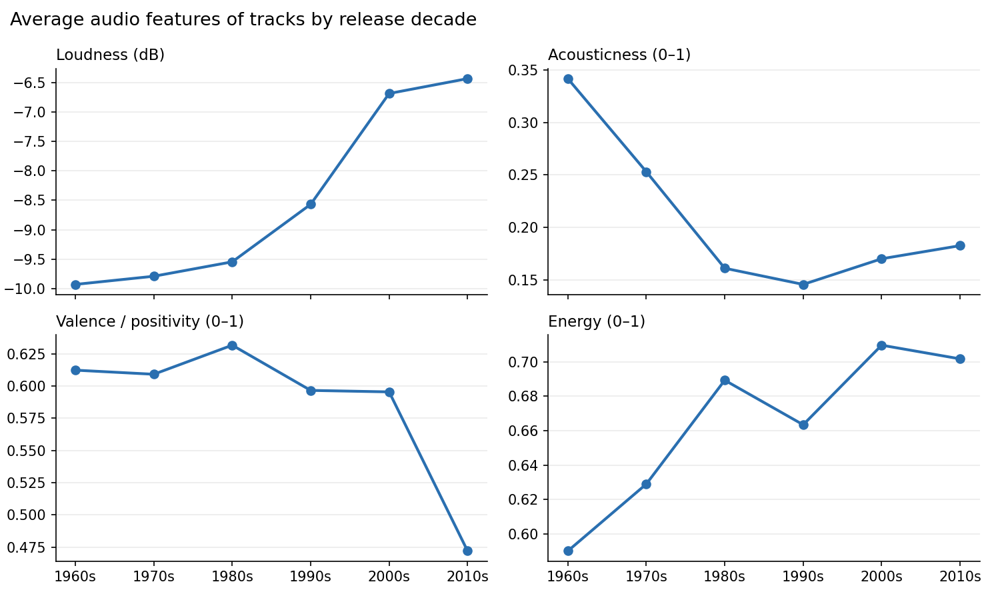
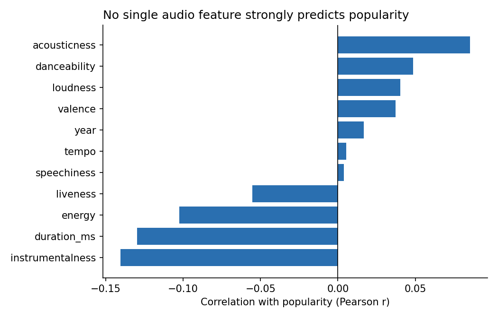
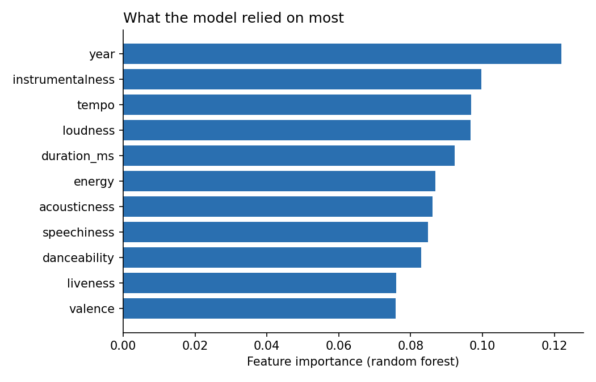

# Spotify Music Trends & Popularity Analysis

**Python · pandas · NumPy · Matplotlib · scikit-learn**

## Summary
I analysed 26,229 unique Spotify tracks (released 1960s–2010s) to see how music has changed over time and whether audio features can predict a track's popularity. Music became louder, more energetic and less acoustic, with a sharp drop in positivity (valence) in the 2010s. Audio features alone predicted popularity only weakly: the best model explained about 15.7% of the variation.

## Questions
1. How have audio features such as loudness, acousticness, valence and energy changed from the 1960s to the 2010s?
2. How well can audio features predict a track's popularity?

## Key findings
- **Louder:** average loudness rose by 3.5 dB, from -9.93 dB in the 1960s to -6.43 dB in the 2010s.
- **More energetic:** energy rose from 0.59 to about 0.70, and it is strongly correlated with loudness (r = 0.69).
- **Less acoustic:** acousticness halved between the 1960s and the 1980s (0.34 to 0.16).
- **Less positive recently:** valence stayed around 0.6 until the 2000s, then fell to 0.47 in the 2010s.
- **Popularity is hard to predict from sound alone:** no single feature correlates with popularity beyond about ±0.14. A random forest explained 15.7% of the variation (R² = 0.157) with an average error of 17.4 points, only about 2 points better than always predicting the average (19.3).







## Method
- **Data:** [TidyTuesday Spotify songs dataset](https://github.com/rfordatascience/tidytuesday/tree/master/data/2020/2020-01-21) (January 2020), 32,833 rows.
- **Cleaning:** removed 5 rows with missing names, removed 6,599 duplicate rows (the same song in several playlists, keeping the most popular copy, with ties broken by track ID so results are reproducible), and parsed release dates that came in three different formats. The 1950s (3 tracks) and 2020 (January only) were excluded from the trend analysis.
- **Analysis:** decade-level averages of each audio feature, and correlations with popularity.
- **Modelling:** a linear regression and a random forest, compared against a "predict the average" baseline on a held-out 20% test set (R² and mean absolute error).

## Limitations
- Tracks come from Spotify playlists, not a random sample of all music, so the 2010s are heavily over-represented (18,722 tracks, against 117 for the 1960s).
- Popularity is a current score, so older songs are not comparable with newer ones.
- Factors such as artist fame, marketing and playlist placement are not in the data and probably explain much of the remaining variation.
- The data ends in January 2020.

## Possible improvements
- Add artist-level information, such as follower counts or previous hits.
- Account for release date when measuring popularity, for example by comparing tracks only with others from the same year.
- Tune the random forest, try gradient boosting, and use cross-validation.

## Run it yourself
```bash
pip install -r requirements.txt
jupyter notebook spotify_analysis.ipynb
```
The notebook downloads the dataset automatically on first run.

## Files
- `spotify_analysis.ipynb` — the full analysis
- `trends_by_decade.png`, `correlations.png`, `feature_importance.png` — charts
- `requirements.txt` — Python packages needed
